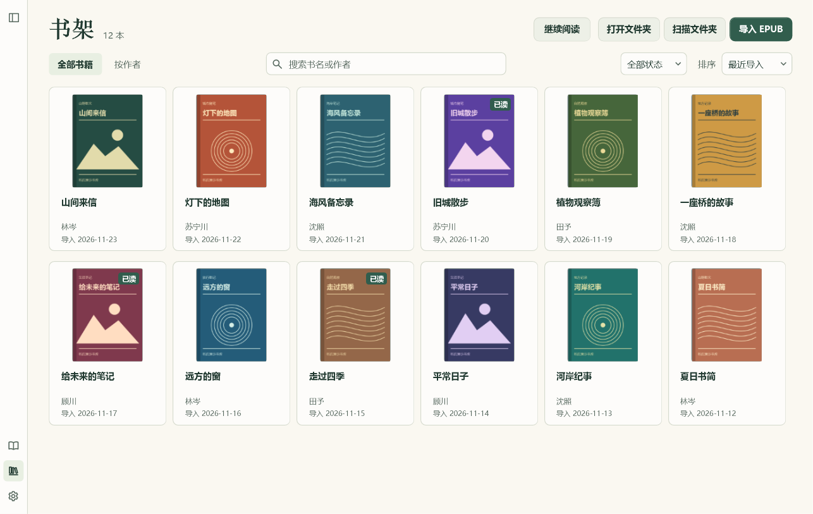
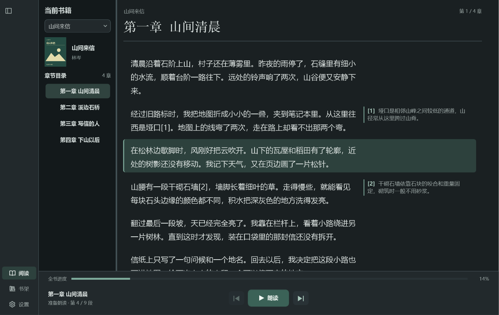
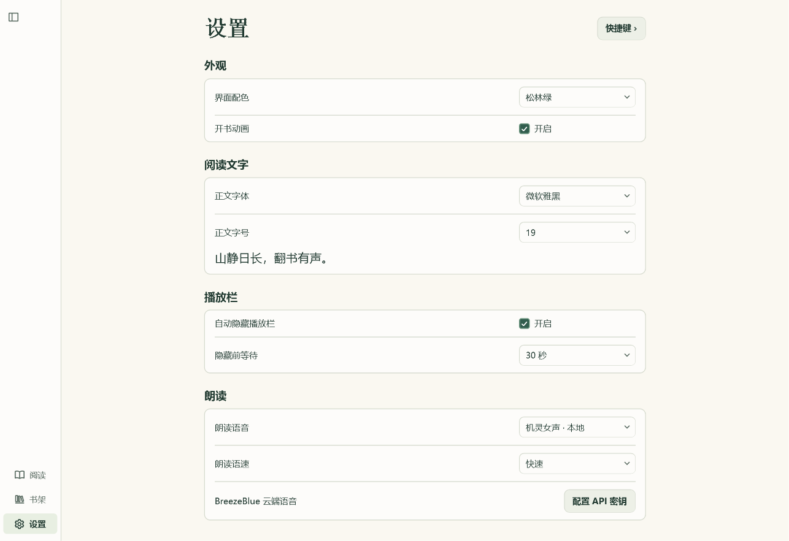

# 听页 · Windows EPUB 阅读和朗读

听页用于阅读和朗读无 DRM 的文字版 EPUB 2 和 EPUB 3。它会记住每本书的章和段落，听到哪里，下次就可以从哪里继续。推荐用 **Breeze TTS 2** 在本机朗读普通话和英语长文，也可以直接用 Windows 系统语音开始听书。

## 下载与上手

1. 在发布页下载 `Tingye-Windows-*.zip`，完整解压后双击 `Tingye.exe`。 [下载 Windows 版](https://github.com/darkknight2333/tingye/releases/latest)
2. 点击「导入 EPUB」，也可以按 `Ctrl+O` 或把文件拖入窗口。
3. 从书架打开书籍。在目录里选章，或点击正文段落选定起读位置，再点「朗读」。听页会高亮当前段落，并接着读后续段落和章节。
4. 在「设置 → 朗读」选择音色和语速。初次使用可先选 Windows 系统语音，装好 Breeze 后选择「机灵女声 · 本地」。

## 使用场景

以下是 Windows 版用演示书籍截取的界面。

### 整理 EPUB，接着上次的位置读

把同一主题的书批量导入书架，按书名或作者搜索，也可以用阅读状态筛选。每本书都有独立的进度，想接着听时点击「继续阅读」。

### 夜间阅读，边看正文边查注释

看带脚注的书时，可以在左侧目录定位章节，在正文右侧直接读已识别的注释。点中段落后就能从那里开始听，听页会跳过已识别的注释及引用编号。

### 听长文，调整音色和语速

装好本地 Breeze 后，在「设置 → 朗读」选择「机灵女声 · 本地」。听散文或小说时可以按自己的节奏调速，播放栏自动隐藏的等待时间也能在同页调整。

## 首选语音 · Breeze TTS 2

Breeze TTS 2 支持普通话和英语。听页使用 **Q4_K** 版，支持边生成边播、相邻段落预生成和语音缓存。首次播放需要加载模型，重复播放已缓存的段落可以省去合成。

从上游下载约 **2.54 GB** 的 `breeze-tts-2-q4_k.gguf`、Windows x64 Vulkan 运行包和 FFmpeg，按导入指南放到 `Tingye.exe` 同级的 `speech/breeze-local`。准备好 `tingye-clever.breeze` 音色文件后重启听页，在「设置 → 朗读 → 朗读语音」手动选中「机灵女声 · 本地」。本地合成无需 API 密钥，正文在本机处理。 [Breeze 安装步骤](VOICE-SETUP.md#breeze-tts-2) · [Q4_K 权重](https://huggingface.co/HoppouAI/Breeze-TTS-2.cpp/blob/main/breeze-tts-2-q4_k.gguf) · [模型许可](https://huggingface.co/BreezeBlue/Breeze-TTS-2/blob/main/LICENSE)

### 电脑配置推荐

建议使用 64 位 Windows 10 或 11。本表按听页使用 **Q4_K** 时所需的资源余量给出选配建议。Breeze 的 Windows Vulkan 运行包要求 CPU 支持 AVX2。 [上游运行包说明](https://github.com/HoppouAI/Breeze-TTS-2.cpp/releases/tag/v0.1.7)

| 使用场景 | CPU 和内存建议 | 显卡和存储建议 |
| --- | --- | --- |
| 基础阅读、Windows 系统语音 | 常用四核处理器、8 GB RAM | 集成显卡即可。另留空间存放 EPUB 和阅读数据 |
| 在现有电脑试用 Breeze | 支持 AVX2 的处理器、16 GB RAM | 支持 Vulkan 的 4–6 GB 独显可尝试，优先用 6 GB。为模型、运行库和初期缓存预留至少 6 GB SSD 空间 |
| 日常使用 Breeze 长时间听书 | 支持 AVX2 的六核处理器、16 GB RAM | 建议 8 GB 或以上显存，例如台式 RTX 4060 8 GB 或 RTX 3060 12 GB。建议预留 10 GB SSD 空间 |
| 听书同时运行其他占用显存的应用 | 支持 AVX2 的六核或以上处理器、32 GB RAM | 建议 12 GB 或以上显存，并按书库和缓存规模留出 SSD 空间 |

上游给出的 Q4_K 推理显存约为 **3 GB**。上表建议更大的总显存，是为了给 Windows、播放器和其他程序留出余量。听页检测到单张不超过 6 GiB 显存的 NVIDIA 卡时，会尝试把 Breeze 的文本编码放到 CPU。上游运行库也支持 AMD、Intel 的 Vulkan 设备及 CPU 回退。核显和纯 CPU 的播放效果以实际试播为准，频繁等段时可用 Kokoro 或系统语音。 [上游显存说明](https://github.com/HoppouAI/Breeze-TTS-2.cpp/blob/main/docs/build.md#troubleshooting) · [低显存模式](https://github.com/HoppouAI/Breeze-TTS-2.cpp/blob/v0.1.7/docs/performance.md#short-on-video-memory) · [RTX 4060 规格](https://www.nvidia.com/en-us/geforce/graphics-cards/40-series/rtx-4060-4060ti/) · [RTX 3060 规格](https://www.nvidia.com/en-us/geforce/graphics-cards/30-series/rtx-3060-3060ti/)

### 其他语音

| 语音 | 适用场景 |
| --- | --- |
| Windows 系统语音 | 解压即可试用，音色取决于系统中可供桌面程序调用的语音 |
| Kokoro | 更轻量的本地中文和英文朗读，安装后可用「自动匹配」按语言选音色 |
| Qwen3-TTS | 本地使用 Serena 或 Vivian 音色 |
| BreezeBlue 在线语音 | 使用自己的 API 密钥。待朗读文本会发给服务商，费用按服务商规则计算 |

第三方模型和运行库由用户按需下载。 [语音导入指南](VOICE-SETUP.md) · [BreezeBlue 密钥管理](https://breezeblue.ai/zh/app/developer/api-keys)

## 书架与阅读设置

- **书架管理**支持按标题和作者搜索，按导入或阅读时间排序，按作者分组，以及标记已读。批量导入可用「打开文件夹」和「扫描文件夹」，听页按内容去重。
- **删除书籍**可在封面右键菜单操作。确认后清除书架记录、阅读进度和书库中的导入副本，保留导入前的原始 EPUB。
- **阅读页面**可用左上角按钮同时折叠章节目录和正文右侧的注释。朗读会跳过已识别的注释及引用编号。
- **外观**可在设置里切换夜间配色，调整字体和字号，或关闭开书翻页动画。启用动画时，全书进度低于 30% 翻一页，30% 到不足 70% 翻两页，70% 起翻三页。按 `Esc` 可跳过本次动画。
- **播放栏**默认在 30 秒后自动隐藏。鼠标移到窗口底部的短横线可唤回，在「设置 → 播放栏」可关闭自动隐藏或调整时间。

### 默认快捷键

| 按键 | 操作 |
| --- | --- |
| `空格` | 在阅读页开始、暂停或继续朗读 |
| `Alt+←` / `Alt+→` | 上一章 / 下一章 |
| `Ctrl+B` | 展开或收起阅读侧栏 |
| `Ctrl+O` | 导入 EPUB |
| `Ctrl+F` | 搜索书架 |

在「设置 → 快捷键」可以修改键位或恢复默认。

## 数据位置与备份

书库、阅读进度、设置和语音缓存默认保存在 `%LOCALAPPDATA%\Tingye`。退出听页后，可以备份该目录中的 `Books` 和 `shelf.xml`，保存导入副本和阅读进度。手动导入的语音模型位于 `Tingye.exe` 同级的 `speech` 目录。

## 从源码编译

在装有 64 位 .NET Framework 4.x 的 Windows 上，用 PowerShell 进入仓库目录并执行 `./Build.ps1`。编译完成后打开生成的 `Tingye.exe`。编译和基础系统朗读可以独立于第三方语音模型运行。
